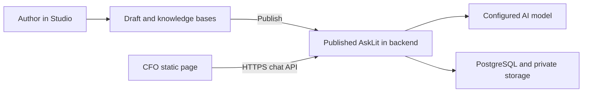

# Connect AskLITs to Court Forms Online

Use Studio to manage the assistant and Court Forms Online (CFO) to decide where
and how visitors encounter it. **You do not need the Studio gallery.** An
unlisted published AskLit can appear on a form landing page, a dedicated CFO chat
page, or a custom CFO page using the chat component.



CFO serves static HTML, JavaScript, and assets. The Python backend owns prompts,
knowledge bases, authorization, conversations, model credentials, and cost
controls. A public GET reads published metadata; it does not run uploaded Python
code or generate a model answer. Conversation creation and messages use POST.

## Author workflow

1. Sign in to [Studio](https://asklit.suffolklitlab.org) and select the organization
   where you have authoring access. A dedicated CFO organization can keep its
   authors and usage together; its owner must invite the editors.
2. Create an AskLit, add knowledge bases and instructions, preview it, and evaluate
   the questions visitors are likely to ask.
3. In **Settings → Sharing**, choose **Unlisted** and **Save access & link**.
   Leave the organization's gallery disabled if it has no need for one.
4. **Save** the draft and **Publish** it.
5. Open **Settings → Sharing → Integration → Copy bot ID**. Give that ID to the
   person configuring the CFO page.

Unlisted means anyone who knows the link or ID can access the assistant. For a
restricted audience, choose shared password or organization sign-in instead;
the frontend supports those access flows, but the visitors must meet the chosen
backend policy. Provider sign-in must also be configured on the backend.

## Configure the static frontend once

In the CFO repository, set the public **backend origin** at build time:

```sh
NEXT_PUBLIC_ASKLIT_API_URL=https://asklit.suffolklitlab.org npm run build
```

The build produces `out/`, which can be served by static hosting. The value is
embedded in the JavaScript: changing it requires rebuilding the frontend. Do not
append `/api`; the component adds API paths itself. This variable is public and
must contain no credentials.

On the backend, allow the exact origins where the frontend is served, for example:

```dotenv
ASKLIT_CORS_ORIGINS=https://courtformsonline.org,https://www.courtformsonline.org
```

Add `http://localhost:3000` only when needed for development. Preserve other
required origins when changing the list. Backend CORS does not publish a draft
or override its access policy. Never put an AWS key, OpenAI key, Supabase service
key, or database URL into a `NEXT_PUBLIC_` variable or form metadata.

## Choose the CFO viewing mechanism

### Form landing page

Add `asklit_id` to the existing **YAML `metadata:` block in the docassemble
interview**, alongside `title` and the other CFO metadata. For example, the
Civil Docketing Statement interview already defines `title`, `short title`,
`description`, `can_I_use_this_form`, and `before_you_start` in
`civil_docketing_statement_standalone.yml`. Adding an AskLit would look like this:

```yaml
---
metadata:
  title: |
    Civil Docketing Statement
  short title: |
    Civil Docketing
  # ... existing description, can_I_use_this_form, before_you_start, etc.
  asklit_id: "0123456789abcdef0123456789abcdef"
  # ... remaining metadata
---
# ... remaining interview blocks
```

The `# ...` comments represent omitted existing content; keep that content in your
file. Replace the illustrative ID with the real value from Studio's **Copy bot
ID** control. Add the field to the existing block rather than creating a second
metadata block or a separate JSON file.

Publish the updated interview package to the docassemble server that supplies
CFO's form catalog, then rebuild CFO so it reads the updated metadata. The catalog
API represents this YAML metadata as JSON in transit; authors edit the YAML
source. The form component renders `AskLitChat` when the ID is valid and the API
origin is configured. Later prompt and knowledge-base updates still happen in
Studio without changing this mapping.

### Standalone chat link

Link directly to:

```text
https://courtformsonline.org/asklit?bot=0123456789abcdef0123456789abcdef
```

The ID is read in the browser. Adding another published assistant this way does
not require generating another static route. The integration also supports
`/asklit?org=lit&slug=housing-help` for organization-prefixed link resolution.
Use the immutable bot ID for mappings that should survive a URL-name change.

### Custom CFO page

Import the component from `src/app/components/AskLitChat.tsx` using the relative
path appropriate to the page, then render:

```tsx
<AskLitChat botId="0123456789abcdef0123456789abcdef" />
```

The component includes chat, citations, attachments when enabled, supported voice
controls, access prompts, student briefings, password-protected instructor notes,
and publisher/AI disclosures. CFO can provide its own
form finder, cards, links, or navigation around it. The generic `/asklit` page
without an assistant parameter also has gallery behavior, but linking to it is
optional and is not required by embedded or ID-based chat.

## Maintain content without rebuilding CFO

| Change | Action |
| --- | --- |
| Instructions, knowledge bases, model, opening message, upload settings | Edit/save in Studio and publish a version. Existing ID-based CFO mappings remain valid. |
| Password entries, access mode, stable link | Use Studio's sharing controls. Access changes can revoke active visitor sessions. |
| Associate a different AskLit with a form | Change the form's `metadata.asklit_id`; refresh/rebuild wherever that data is incorporated. |
| Add a link to an existing published AskLit | Use its ID-based URL in CFO's navigation. |
| Change backend origin | Change `NEXT_PUBLIC_ASKLIT_API_URL`, rebuild CFO, and verify backend CORS. |
| Temporarily stop an assistant | Unpublish it in Studio. |
| Close a school | Archive its organization in Admin; all its assistants pause. |

Publishing changes affects new conversations. Do not use publication alone as a
sensitive-data revocation procedure for conversations already underway.

## Verify the complete connection

1. Open the published assistant directly from Studio in a signed-out browser.
2. Open its CFO ID-based URL. Confirm the expected title and organization appear.
3. Send one short question. For deployment tests, use a disposable assistant with
   the operator's `tiny` preset rather than an expensive evaluation matrix.
4. Check the answer and citations, then clear the conversation.
5. If uploads are enabled, test a small synthetic text file. Do not use real
   identifying information for a smoke test.
6. For restricted assistants, verify that an unauthorized visitor cannot chat.
7. Edit a harmless draft detail. Confirm public metadata remains unchanged until
   publication; start a new conversation to test the published update.
8. Check the school's usage report for the expected request and estimated cost.

The AskLit integration PR and its tests are in the
[CFO repository](https://github.com/SuffolkLITLab/courtformsonline.org). A successful
Studio deployment does not by itself deploy that frontend repository. Confirm the
integration branch is merged and the CFO host has rebuilt before expecting the
component on the main CFO website.

## Troubleshooting

| Symptom | Check |
| --- | --- |
| No chat panel on a form | Valid `metadata.asklit_id`, frontend build variable, and whether updated form data reached the page. |
| “AskLit is not configured for this site” | Build-time API origin; setting it only on a static web server after building has no effect. |
| Browser network/CORS error | HTTPS certificate, exact allowed origin including `www` and port, and backend reachability. |
| Assistant unavailable | Real ID, published version, active organization, and access mode. |
| Draft edits do not appear | Save and Publish; begin a new conversation. |
| Unexpected gallery | Supply `?bot=ID`, use `?org=PREFIX&slug=NAME`, or embed the component. |
| Billing/quota message | Use its reference code and the [Admin usage guide](studio-administration.md#monitor-requests-and-cost); do not keep retrying. |
| Organization sign-in cannot return to CFO | Backend OAuth callback registration, allowed CFO origin, and popup restrictions. |
