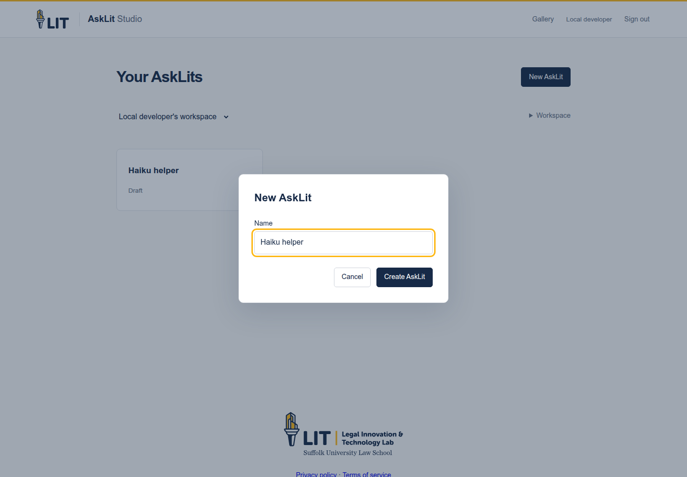
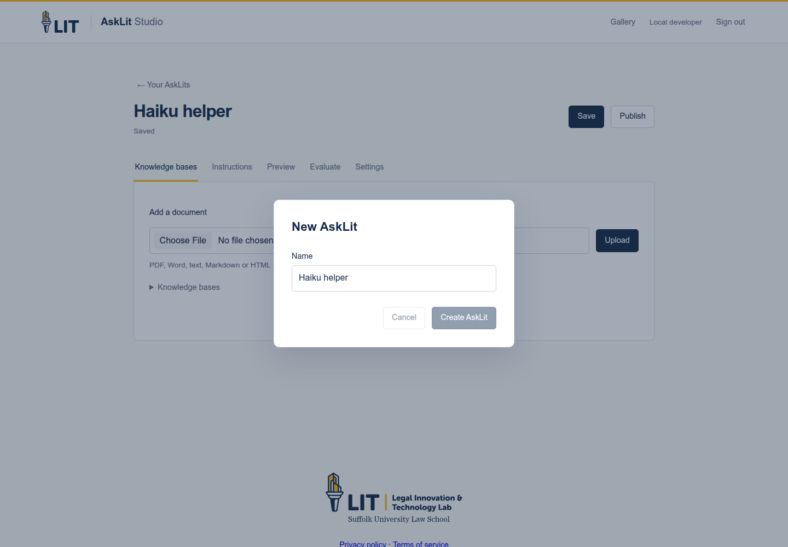
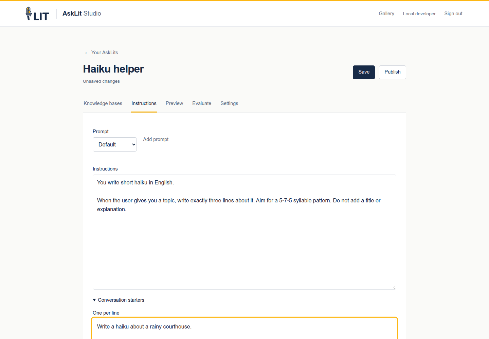
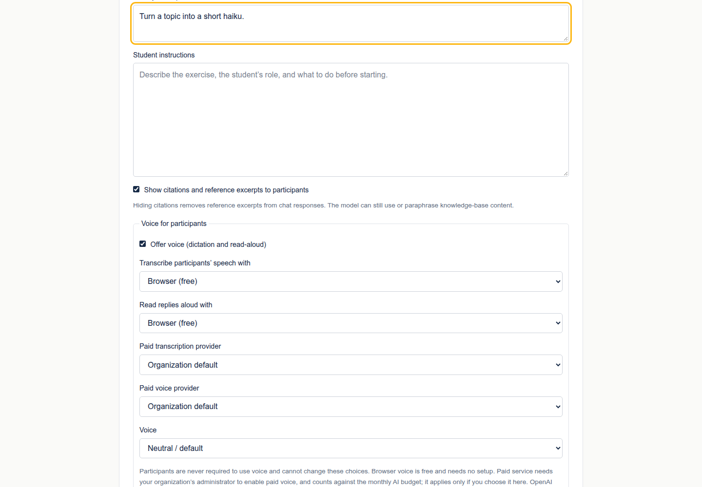
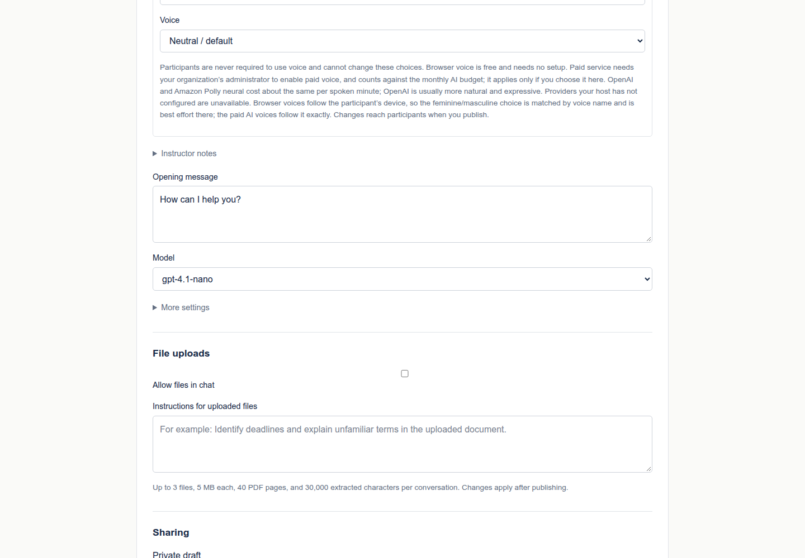
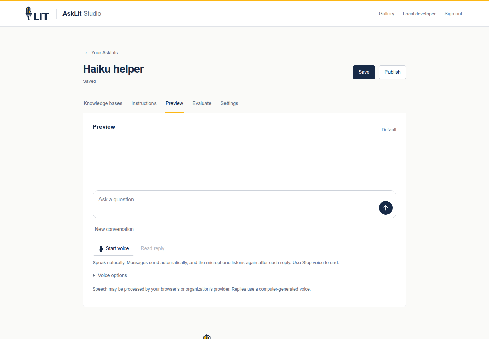
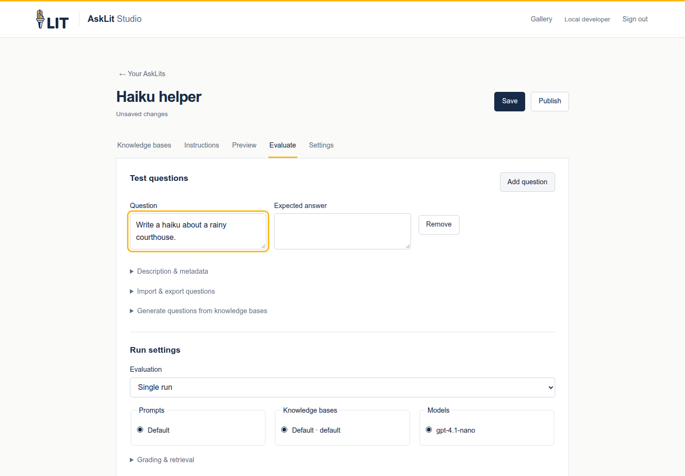
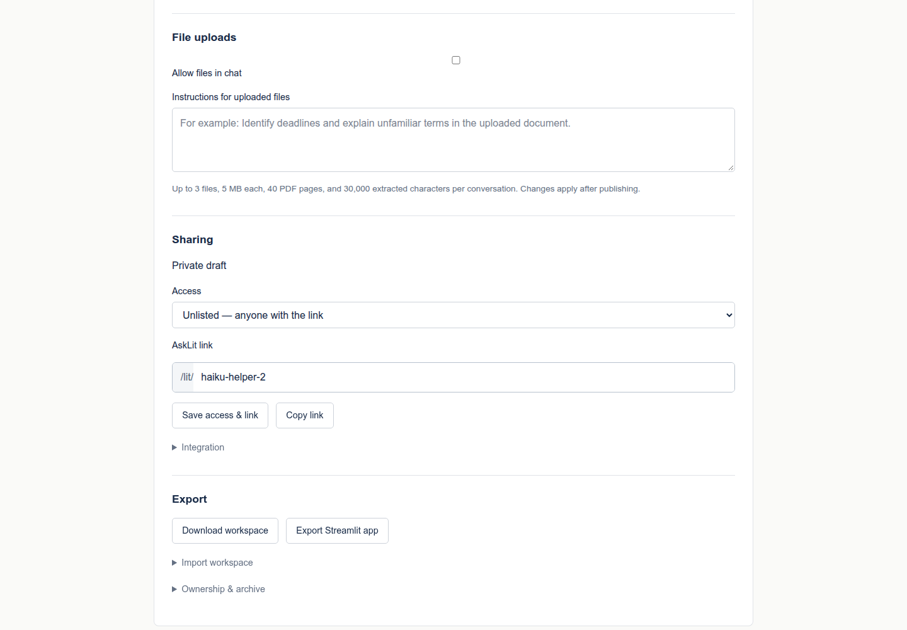
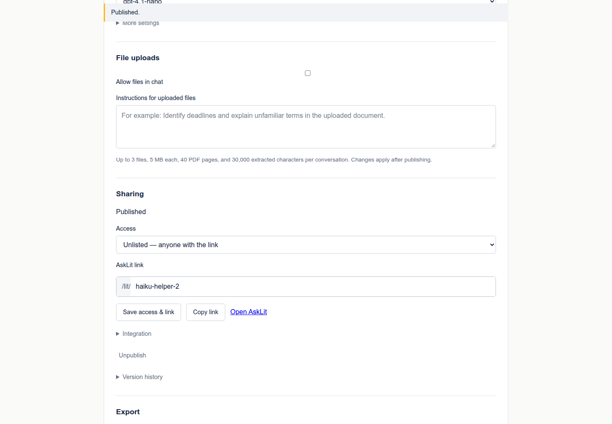

# Manage AskLITs in Studio

[AskLit Studio](https://asklit.suffolklitlab.org) keeps your assistants, prompts,
knowledge bases, and published versions in one account. Use it to maintain an
assistant over time, collaborate within a school, or provide the backend for a
separate website such as Court Forms Online.

The [Streamlit Scaffolder](streamlit.md) is deprecated. Existing standalone
apps run independently of Studio; publishing here does not update them.

## Sign in and obtain hosting approval

During the open-registration trial through December 2026, choose **Create account**
on the sign-in page to create a local account and workspace without approval or a
hosting fee. A configured Google sign-in also works where the provider permits it.
The trial is scheduled to end January 1, 2027 at 00:00 UTC unless extended.

Outside an open-registration period, hosting on `suffolklitlab.org` requires
approval and a small fee to recover hosting and AI usage costs. Email [litlab@suffolk.edu](mailto:litlab@suffolk.edu) with your
account email, school or organization, and intended use. The Lab arranges pricing
and usage allowances; Studio does not currently collect payments or enforce a
professor seat count.

Use the email/password form for a local Studio account, or an available Google or
Microsoft sign-in button. OAuth buttons depend on the deployment's configuration.
A local account does not require either provider. Using the same email with
multiple login methods does not automatically merge accounts.

An invitation from a service administrator can create your account in a specific
organization **with hosting approval included**. Follow the invitation, use the
specified email, and create a local password or use a configured sign-in provider.
Invitations expire after seven days and can be used once. If you already have a
local account, sign in; local accounts are managed by one organization, so ask the
Lab if an invitation targets a different school.

## Build and publish your first AskLit

This walkthrough builds a **Haiku helper** with no source documents. You can
adapt the same steps to a tutor, simulation, or document-based assistant. The
screenshots show a local demonstration of Studio; its sign-in form and model list
can differ from the hosted service. The example is published only locally.

### 1. Sign in and create the app

1. Open [asklit.suffolklitlab.org](https://asklit.suffolklitlab.org).
   Sign in, create an account if registration is open, or follow an invitation.
   If hosting approval is required, follow the instructions above.
2. On **Your AskLits**, choose the organization that should own the app.
3. Choose **New AskLit**, enter `Haiku helper`, and select **Create AskLit**.
   Studio opens the editor on **Knowledge bases**.



### 2. Add reference materials if needed

For this example, leave **Knowledge bases** empty: a poetry exercise does not
need a source packet. For a source-based assistant:

1. On **Knowledge bases**, choose a PDF, Word, text, Markdown, or HTML file
   (up to 10 MB per file), then choose **Upload**.
2. Wait for the document to be ready before testing. Check for errors and replace
   files whose text cannot be extracted. Upload additional documents as needed.
3. Expand **Knowledge bases** to choose or name a separate source collection.
   In **Instructions → Prompt settings**, connect the prompt to that collection;
   leave **Connected filenames** blank to use all its documents, or list specific
   filenames one per line.



Use materials you have permission to share. An assistant can disclose content
from its sources in its answers, even when citations are hidden. An empty or
irrelevant collection does not prevent a model from answering from its general
knowledge, so test missing-information cases carefully.

### 3. Write instructions

1. Choose **Instructions** and enter this in the instructions box:

   ```text
   You write short haiku in English.

   When the user gives you a topic, write exactly three lines about it.
   Aim for a 5-7-5 syllable pattern. Do not add a title or explanation.
   ```

2. Expand **Conversation starters** and add `Write a haiku about a rainy courthouse.`
3. Choose **Save**. For other tasks, specify the role, audience, desired response,
   trusted sources, and what to do when the answer is missing. Use **Add prompt**
   if you need another profile, and configure its source under **Prompt settings**.



### 4. Choose a model and voice settings

Choose **Settings**. Set the **Title**, **Gallery description**, and **Opening
message** to help visitors understand the app. Add **Student instructions** if
participants need a briefing before chat; it is separate from the opening message.



Under **Voice for participants**, decide whether to leave **Offer voice (dictation
and read-aloud)** checked. Voice is optional for participants and browser voice is
on by default. It can make an exercise more accessible or conversational, but
microphone permission, device support, recognition accuracy, and the participant's
surroundings affect the experience. Test with the devices and languages your
participants use, and provide a text alternative.

Choose **Browser (free)** for transcription and read-aloud to avoid paid speech
charges. Browser speech may still be processed by the browser vendor. A paid
speech service requires a configured provider and organization administrator
enablement; it uses the organization's budget in addition to normal model calls.
The hosted Suffolk monthly-budget configuration currently disables paid speech.
When available, you can choose transcription and read-aloud separately and set
a voice persona. Browser voice selection depends on the participant's device.
Participants cannot change the author's provider choices. Save and publish voice
changes before participants see them. Review the hosted [privacy policy](https://asklit.suffolklitlab.org/privacy).



Under **Model**, choose from the models available to your organization. Start
with a smaller, lower-cost model for a simple task, and compare it with a more
capable model when the task requires nuanced instructions, reliable source use,
or complex reasoning. More capable models can cost more or respond more slowly;
a larger model is not automatically more accurate. Availability and pricing can
change, so check with your organization or the Lab. Preview and evaluation calls,
as well as visitor conversations, consume model usage. Compare models on the
same representative questions, including hard and unanswerable cases, before
selecting the least costly option that performs adequately. Model choice does not
replace human review or guarantee correct legal information.

Choose **Save** after changing these settings.

### 5. Preview and evaluate

1. Select **Preview**, enter `Write a haiku about a rainy courthouse.`, and send it.
   Check whether the response follows the instructions. Try a different topic and
   a request outside the app's scope; revise the instructions and save as needed.
2. If using documents, ask a question answered by a source and one not answered
   by it. Check the response and the displayed sources; a citation is not proof
   that the answer is correct.
3. Select **Evaluate**, choose **Add question**, and enter a representative test
   and an expected answer or rule. Add more cases, select the prompts, knowledge
   bases, and models to compare, and choose **Run evaluation**. Review failures
   and the displayed call count; rubric judges can add model calls.

Include direct source questions, paraphrases, edge cases, missing information,
and requests outside the assistant's scope. For a simple check, use an expected
answer such as `icontains:violet` for a test whose source specifies that color;
under **Grading & retrieval**, add shared
rubric rules when a rigid text match is insufficient. An AI judge can also make
mistakes, so review individual answers and sources. A passing test measures only
the cases and rules you selected; it is not a guarantee of accuracy.





### 6. Set access and publish

1. Return to **Settings → Sharing**. Choose **Public**, **Unlisted**, **Shared
   password**, or **Organization sign-in** based on who should use the app.
   Unlisted links can be opened by anyone who has them. Public gallery listing
   also requires the organization gallery to be enabled.
2. Check the **AskLit link** URL name and select **Save access & link**. For a
   shared password, add an enabled password in the controls that appear. Share
   the password separately with intended participants.
3. Review your instructions, sources, model, voice, and access choice. Choose
   **Publish** at the top of the editor and confirm. Studio saves the draft and
   creates a published version.
4. Under **Settings → Sharing**, choose **Open AskLit** to test the published
   experience, ideally in a private browser window or as an intended participant.
   Use **Copy link** to share it after checking access and a representative chat.
   For organization access, test with an authorized account.





After editing the content, **Save** and **Publish** again to give new
conversations the updated version. Access and link changes use **Save access &
link** and take effect separately. See [Drafts, publication, and updates](#drafts-publication-and-updates)
and [Access, links, and galleries](#access-links-and-galleries) below.

Ordinary members can edit their own AskLits. Organization administrators can
manage all AskLits in their organization. Owners also manage administrator and
owner roles. Platform **Admin** access manages the service, approvals, and schools;
it does not automatically make an operator a member of every school.

## Drafts, publication, and updates

**Save** changes the draft. **Publish** creates a version for public users.
Changing a draft does not silently change the published version. New conversations
use the current published version; existing conversations can remain on the
version they started with. If sensitive material was published accidentally,
unpublish the assistant and contact the Lab rather than assuming a new publication
removes every previous conversation or stored record.

**Settings → Sharing → Version history** provides publication history.
**Unpublish** stops public access without deleting the saved draft. Archiving an
organization also pauses all its hosted AskLits. A frontend that already refers
to an AskLit ID continues to use that ID after you publish updates.

## Access, links, and galleries

In **Settings → Sharing**, choose an access mode, then use **Save access & link**.
These controls are separate from saving and publishing the content draft.

| Access mode | Who can open the assistant | Gallery behavior |
| --- | --- | --- |
| Public | Anyone | Eligible for listing when the organization gallery is enabled |
| Unlisted | Anyone with its link or ID | Not listed |
| Shared password | Visitors with an enabled per-AskLit password/code | Not listed |
| Organization sign-in | Authorized organization members or matching verified provider rules | Not listed |

**Unlisted is not private.** Use it for a public CFO assistant that should appear
only in CFO's own navigation. Use password or organization access when visitors
must be restricted. Shared passwords have no visitor usernames; you can create
multiple entries and disable them separately.

A stable link looks like `https://asklit.suffolklitlab.org/lit/housing-help`.
The organization controls `/lit/`; the author edits only `housing-help` in the
AskLit link field. URL names use lowercase letters, numbers, and dashes. Changing
the display name later need not change the established link.

Organization owners/admins configure the gallery in **Workspace → Members &
settings → Gallery, links & sign-in**. A saved draft alone does not appear:
the AskLit must be published, set to Public, and belong to an active organization
whose gallery is enabled. There is no intentional waiting period for listing.

For another frontend, use **Settings → Sharing → Integration → Copy bot ID**.
See [Connect Court Forms Online](court-forms-online.md).

## Run a simulation

Use **Settings → Student instructions** for the student’s role, exercise goals,
and preparation. This briefing can be up to 30,000 characters and appears above
the chat. It is separate from the opening message. Save and Publish to make it
visible to participants.

Uncheck **Show citations and reference excerpts to participants** when revealing
the source packet would spoil the simulation. Hidden excerpts are omitted by the
server, not merely concealed in the page. This setting does not guarantee that
the model cannot quote or paraphrase reference material it receives: put material
that the model must never see in Instructor notes instead of its knowledge base.

New AskLits retrieve at most three passages by default. Under **More settings**,
change **Maximum reference passages** when an exercise needs more context.
The maximum is a ceiling, not a quota: weak or duplicate matches are filtered.
Existing AskLits keep their saved limit. Visible references appear together under
**Sources**; they are retrieved passages, not a guarantee of which passages the
model relied on. Fewer passages reduce prompt size without an extra AI call,
but model generation and first-use embedding initialization also affect latency.

### Instructor notes

Under **Settings → Instructor notes**, enter teaching notes, assessment criteria,
or information that students should not see. These notes stay separate from
student instructions, published configuration, and the model's context. They are
not included in workspace downloads or Streamlit exports.

By default, only the author and authorized Studio collaborators can read them.
To share with instructors without Studio access, enable **Let instructors view
these notes with a separate password** and set a password of at least 12
characters. Instructors open **Instructor notes** on the chat page and enter that
password. Save applies note/password changes immediately, independently of
publishing the exercise. Leave the password field blank to retain it; uncheck
sharing to turn password access off.

The server checks the password before sending notes. Changing the password or
disabling sharing blocks subsequent requests, but cannot recall text someone has
already read or copied. A shared password can be passed to students; reserve
highly sensitive material for a system appropriate to that information.

## Visitor uploads and voice

In **Settings → File uploads**, enable chat attachments and optionally provide
instructions for interpreting them. Publish those changes. Visitors use the
paperclip control. Limits are three files, 5 MB each, 40 PDF pages, and 30,000
extracted characters per conversation. Supported converters and rejection rules
are enforced on the backend. Visitor attachments belong to that conversation;
they do not become the assistant's permanent knowledge base.

Browser speech input/output is the baseline voice option, subject to browser
support and microphone permission. In hands-free mode, the assistant can listen,
send a completed utterance, speak the answer, and listen again until stopped or
a session limit is reached. Browser speech recognition may use the browser
vendor's services; it is not a promise of offline processing.

Organization administrators can allow paid speech only when the deployment has
configured a suitable provider. The Suffolk monthly-budget configuration currently
disables paid speech; browser voice remains available. AI answers still incur
normal model usage even when speech itself is browser-based.

Public chat identifies the organization and AskLit ID and explains that AI can
make mistakes. Do not ask visitors to provide passwords, bank account numbers,
or identifying numbers. Consult the hosted [privacy policy](https://asklit.suffolklitlab.org/privacy)
and [terms](https://asklit.suffolklitlab.org/terms).

## Export and recovery

**Settings → Export** offers a workspace download and a Streamlit app export.
An export is a separate artifact: deploying it does not keep it synchronized with
Studio. Keep source documents and credentials according to your institution's
policies. Workspace import is intended for an empty AskLit and does not import
server credentials or execute uploaded application code.

For account, quota, or organization issues, see
[Administer hosted AskLITs](studio-administration.md).

For a short follow-up with no strong standalone match, retrieval keeps the best passage for continuity. Citation hiding applies to participant responses; authors and evaluation judges retain access to reference passages.
